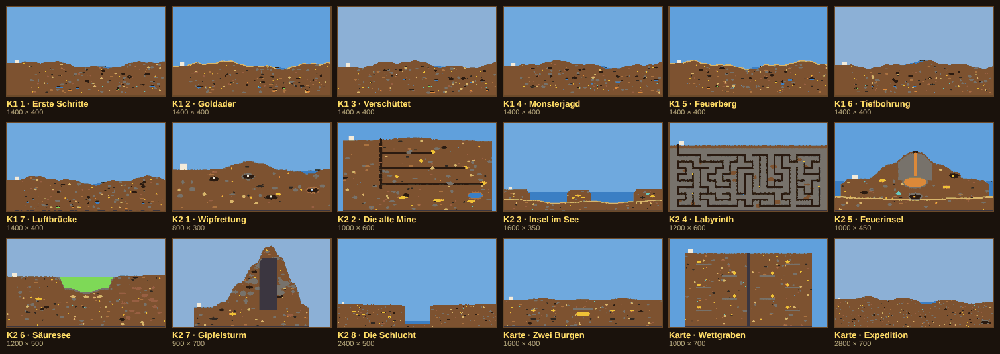

# Plan: Bessere Levelauswahl mit Bildvorschau

> **Stand: Plan, noch nicht umgesetzt.** Baut auf v1.36.0 auf.

**Kurz:** Eine Bildvorschau ist **nicht zu viel Aufwand**. Ein Prototyp (unten) hat Vorschaubilder
aller 18 Level und Karten aus den echten Welten erzeugt; jedes Bild ist 1–6 KB groß, alle
zusammen etwa 60 KB. Der größere Teil der Arbeit ist nicht das Bild, sondern ein eigener Bildschirm
für die Auswahl statt der heutigen Liste. Geschätzt sind das drei Etappen mit mittlerem Aufwand.

---

## 1. Bestandsaufnahme

Heute gibt es zwei Wege, etwas zu starten:

- **Kampagne:** Spielmodus-Knopf auf „Kampagne“, dann „Spielen“. Es öffnet sich das normale
  Panel (höchstens 480 px breit) mit einer Liste aus 15 Knöpfen in zwei Spalten: Symbol, Name,
  Zielzeile, Sterne oder 🔒. Kapitel 1 und 2 sind Abschnitte untereinander
  (`campaignPanel` in `src/scenarios.js`).
- **Karten und Spielmodi:** Der Spielmodus-Knopf in der Lobby schaltet bei jedem Antippen eins
  weiter: Goldrausch → Siedler → Schatzsucher → 3 Karten → Kampagne (7 Schritte,
  `tap('lbGMode')` in `src/lobby.js`).

| # | Problem | Folge |
|---|---|---|
| A1 | Kein Bild | Die Level sind nur Namen. Was eine Karte besonders macht (Vulkan, See, Labyrinth), sieht man erst im Spiel. |
| A2 | Nichts zum Lesen vor dem Start | Einleitung, Ziele und Gefahren kommen erst als Meldung im Spiel. |
| A3 | Sternzeiten unsichtbar | „3 Sterne unter 6 Min.“ steht erst auf dem Ende-Bildschirm, wenn man schon gewonnen hat. |
| A4 | Gesperrt ohne Grund | Ein 🔒 sagt nicht, was man tun muss („1 Stern in Wipfrettung“). |
| A5 | Lange Scroll-Liste im kleinen Panel | Auf dem Handy im Querformat sieht man 4–6 von 15 Leveln; das nächste offene Level muss man suchen. |
| A6 | Karten nur durch Durchschalten | 7 Schritte im Kreis, ohne Beschreibung außer der Zielzeile. |
| A7 | Keine Bestzeit | Das Profil kennt nur Sterne (`P.campaign`). |

---

## 2. Prototyp: Vorschau aus der echten Welt

Ein Skript hat jede Welt mit ihrem Seed erzeugt und Pixel für Pixel in den Kartenfarben gemalt
(1 Bildpunkt = 2 Weltpixel, Himmel in der Farbe des Bioms). Die Burg ist hell markiert, Ziele wie
eingeschlossene Wipfe und Truhen ebenfalls.



Was der Prototyp zeigt:

1. **Kapitel 2 und die Karten sind sofort zu erkennen:** der Vulkan, der Säuresee, das
   Labyrinth, die Schlucht, der Berg mit Granitkern.
2. **Kapitel 1 sieht siebenmal gleich aus.** Das sind Zufallswelten aus festem Seed, und das
   Besondere steckt in der Aufgabe, nicht in der Landschaft. Für sie braucht die Vorschau
   **Markierungen** (verschüttete Wühler, Monster, Vulkanausbruch) und das Symbol der Aufgabe
   groß im Bild.
3. **Erzeugen ist zu langsam für die Lobby:** 0,4–2 s pro Welt, und es überschreibt die laufende
   Welt. Die Bilder müssen also **vorher** entstehen, nicht beim Öffnen der Auswahl.
4. **Klein:** Als PNG mit 32 Farben 1–6 KB pro Bild (Schlucht 1 KB, Labyrinth 3 KB).

---

## 3. Ziele

1. **Ein Bildschirm für alles, was man startet:** Kampagne, Karten und Spielmodi.
2. **Sehen, worauf man sich einlässt:** Bild, Einleitung, Ziele, Gefahren und Sternzeiten vor
   dem Start.
3. **Das nächste Level ist offensichtlich:** Es ist hervorgehoben und beim Öffnen schon im Bild.
4. **Handy zuerst:** Querformat ab 360 px Höhe, mit dem Daumen bedienbar; am Desktop mit den
   Pfeiltasten und Enter.
5. **Auch im Mehrspieler:** Der Host wählt die Karte mit Bild, die Gäste sehen die Wahl.

---

## 4. Der Auswahl-Bildschirm

Er ersetzt das 480-px-Panel der Kampagne und das Durchschalten des Spielmodus-Knopfs. Er
füllt den ganzen Bildschirm, im Stil der Lobby (Holzrahmen, Pixelschrift).

**Übersicht:** Reiter oben, darunter Karten mit Vorschau. Das nächste offene Level trägt ein
Band „Weiter“ und ist beim Öffnen sichtbar.

```
┌──────────────────────────────────────────────────────────────────────┐
│ ‹ Zurück   [ Spielmodi ]  [ Kapitel 1 ★9/21 ]  [ Kapitel 2 ★4/24 ]  [ Karten ] │
├──────────────────────────────────────────────────────────────────────┤
│ ┌──────────────┐ ┌──────────────┐ ┌──────────────┐ ┌──────────────┐   │
│ │   (Bild)     │ │   (Bild)     │ │ ▶ WEITER     │ │   (Bild)  🔒 │   │
│ │              │ │              │ │   (Bild)     │ │   abgedunkelt│   │
│ │1 Wipfrettung │ │2 Alte Mine   │ │3 Insel im See│ │4 Labyrinth   │   │
│ │ ★★★          │ │ ★★☆          │ │ ☆☆☆          │ │              │   │
│ └──────────────┘ └──────────────┘ └──────────────┘ └──────────────┘   │
│ ┌──────────────┐ ┌──────────────┐ …                                   │
└──────────────────────────────────────────────────────────────────────┘
```

- Handy quer: 3 Karten pro Zeile, die Liste scrollt senkrecht. Desktop: 4–5 pro Zeile.
- Gesperrte Level zeigen ihr Bild abgedunkelt; so macht schon die Vorschau neugierig.
- Der Reiter merkt sich, wo man zuletzt war (Profil).

**Detail:** Ein Tipp auf eine Karte öffnet die Ansicht davor. Ein zweiter Tipp auf dieselbe
Karte startet direkt.

```
┌──────────────────────────────────────────────────────────────────────┐
│ ‹ Kapitel 2                                      3 · Insel im See    │
│ ┌───────────────────────────────┐  Deine Insel ist klein und hat     │
│ │                               │  kaum Holz. Auf den Nachbarinseln  │
│ │        (großes Bild)          │  liegt Gold – bau dir ein Floß.    │
│ │                               │                                    │
│ └───────────────────────────────┘  Ziel   🪙 600 Taler               │
│  Wiese · 1600 × 350                Gefahr  💧 Wasser im Stollen       │
│                                    ★★★ unter 12 Min. · ★★ unter 18    │
│                                    Bestzeit 14:20                    │
│                                    [        Spielen        ]         │
└──────────────────────────────────────────────────────────────────────┘
```

- **Gefahren** kommen automatisch aus dem Level: Regeln (Beben, Vulkane, Meteore), Zeichen der
  Karte (Säure, Lava, Wasser), Objekte (Monster, Gas) und das Zeitlimit.
- **Gesperrt:** statt „Spielen“ der Grund, z. B. „Erst 1 Stern in Die alte Mine“.
- **Karten** zeigen zusätzlich „Koop“ oder „Versus“ (wenn eine zweite Burg da ist).
- **Spielmodi** (Goldrausch, Siedler, Schatzsucher) bekommen eine Karte mit großem Symbol statt
  Vorschau; ihre Welt entsteht ja erst beim Start.

---

## 5. Die Vorschaubilder

| Punkt | Entscheidung |
|---|---|
| Wann | Im Voraus: `npm run previews`, ein Playwright-Skript wie `store-shots`. Es erzeugt jedes Level und jede Karte mit ihrem Seed. |
| Wohin | `public/levels/<id>.png`, zusätzlich `public/levels/previews.json` mit der Prüfsumme der Welt, aus der das Bild entstand. |
| Aussehen | Wie im Prototyp: Kartenfarben, Himmel nach Biom, 1 Bildpunkt = 2 Weltpixel, 32 Farben. Markiert werden die Burg(en), die Ziele (Wipfe, Wühler, Truhen, Bereiche bei „erreichen“), Monster und Vulkan-/Lavaorte. |
| Größe | 1–6 KB pro Bild, rund 60 KB für alle. Die Bilder liegen im Offline-Speicher (PNG ist schon in `globPatterns`). |
| Veraltet? | Der Level-Test vergleicht die Prüfsumme der Welt mit `previews.json`. Ändert sich ein Level oder der Generator, schlägt er an: „Vorschau neu erzeugen“. Das ist derselbe Weg wie beim Einfrieren von Kapitel 1. |
| Ohne Bild | Ein Entwurf aus dem Editor oder ein neues Level ohne PNG wird direkt aus `map.txt` gemalt (ohne Zufallszonen und Aufrauen, dafür sofort). So geht die Auswahl nie leer aus. |
| Karten mit Zufall | Karten für freies Spiel füllen ihre `?`-Zonen jede Runde neu; das Bild zeigt eine Beispielrunde. Die Form der Karte, also das Wichtige, stimmt immer. |

Die Alternative wäre ein **echter Screenshot im Spiel-Look** (Texturen, Burg, Bäume) vom Startbereich.
Er ist hübscher, zeigt aber nur einen kleinen Ausschnitt, etwa ein Fünftel der Welt, und kostet
15–30 KB pro Bild. Für die Auswahl ist die Übersicht nützlicher. Als großes Bild in der
Detailansicht ließe sich der Screenshot später ergänzen.

---

## 6. Kleinere Ergänzungen

| # | Was | Wo |
|---|---|---|
| E1 | Bestzeit je Level (`P.campaignTime[id]`), angezeigt in der Detailansicht | `scenarios.js` (`recordCampaign`), `profile.js` |
| E2 | Ende-Bildschirm nach einem Sieg: Knopf „Nächstes Level“ neben „Zur Lobby“ | `main.js` (`endScreen`) |
| E3 | Lobby: Der Spielmodus-Knopf öffnet die Auswahl, statt durchzuschalten. Die Lobby zeigt danach das kleine Vorschaubild der Wahl. | `lobby.js`, `lobby.css` |
| E4 | Mehrspieler-Raum: Der Host sieht die Reiter Spielmodi und Karten (keine Kampagne), die Gäste sehen die gewählte Karte mit Bild in der Lobby | `lobby.js`, `lobbyinvite.js`, `net/room.js` (`cfg` trägt die Wahl) |
| E5 | Der Editor zeigt beim Probespielen keine Auswahl; „Vorschau neu erzeugen“ steht in `docs/LEVELS.md` | `docs/LEVELS.md` |

---

## 7. Etappen

| Etappe | Inhalt | Ergebnis | Aufwand |
|---|---|---|---|
| 1 | `npm run previews`, `public/levels/*.png` und `previews.json`, Test auf veraltete Bilder, Ersatzbild aus `map.txt` | Für jedes Level ein Bild | S–M |
| 2 | Auswahl-Bildschirm: Reiter, Karten-Raster, Detailansicht, Sperrgrund, Gefahren, Sternzeiten, Bestzeit (E1); Tastatur und Touch; Texte DE/EN | Kampagne und Karten mit Bild | M |
| 3 | Lobby-Einbindung (E3), Spielmodi als Karten, Mehrspieler-Raum (E4), „Nächstes Level“ (E2) | Ein Weg für alles, auch im Raum | M |

Jede Etappe ist ein eigener PR mit Tests:

- **Level-Test:** Jedes Level hat ein Bild, und das Bild passt zur Prüfsumme der Welt.
- **Auswahl-Test:** Reiter wechseln, Level öffnen, ein gesperrtes zeigt seinen Grund, Start aus
  der Detailansicht, Pfeiltasten und Enter.
- **Bildtest (`test:visual`):** Die Auswahl auf Handy-Größe (740 × 360) und am Desktop, auf
  Deutsch und Englisch.

---

## 8. Risiken

| Risiko | Gegenmaßnahme |
|---|---|
| Bilder veralten unbemerkt | Prüfsummen-Test (Abschnitt 5) |
| Kapitel 1 bleibt im Bild langweilig | Markierungen für die Aufgabe und das Aufgaben-Symbol groß auf der Karte; sonst lohnt sich ein Ausschnitt im Spiel-Look nur für Kapitel 1 |
| Kleine Handys (360 px hoch) | Karten skalieren mit, Detailansicht stapelt Bild und Text untereinander; Bildtest in dieser Größe |
| Bildschirm wird langsam | 18 kleine Bilder, kein Erzeugen zur Laufzeit; die Liste baut sich beim Öffnen in unter 50 ms auf (messen) |
| Mehrspieler: Gäste sehen eine andere Wahl als der Host | Die Wahl kommt mit der vorhandenen `cfg`-Nachricht des Hosts, wie heute Koop/Versus |

---

## 9. Offene Fragen

1. Sollen auch die **Spielmodi** (Goldrausch, Siedler, Schatzsucher) in den neuen Bildschirm?
   Empfehlung: ja, dann gibt es einen Weg für alles, und das Durchschalten entfällt.
2. **Stil der Vorschau:** Kartenübersicht wie im Prototyp (empfohlen) oder Ausschnitt im
   Spiel-Look?
3. **„Nächstes Level“** direkt auf dem Ende-Bildschirm: gewünscht?
