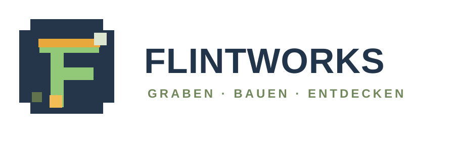
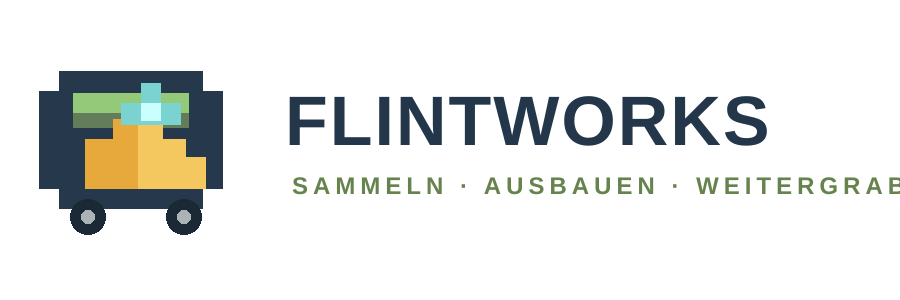

# Flintworks – fünf Logoideen

Alle Entwürfe sind eigenständige, transparente SVGs. Die fünf Richtungen greifen die Spielwelt auf: den Glutstein und die nächtliche Mine, Werkzeug und Crew, den Stollen sowie Sammeln und Ausbau. Sie sind Konzeptvarianten und ersetzen noch kein Logo in der App.

## 1. Glutstein

Der leuchtende Feuerstein als klares, warmes Markenzeichen.

## 2. Pickaxe-F

Ein werkzeugförmiges F mit pixeligem Rahmen – kompakt und gut als App-Symbol.

## 3. Stollenfenster

Der Blick durch den Stollen auf die goldene Welt darunter.

## 4. Crew-Wappen

Ein Abzeichen für die Wühler-Crew und ihren gemeinsamen Aufbruch.

## 5. Goldkarren

Förderwagen, Gold und Kristall stehen für Sammeln und Fortschritt.
